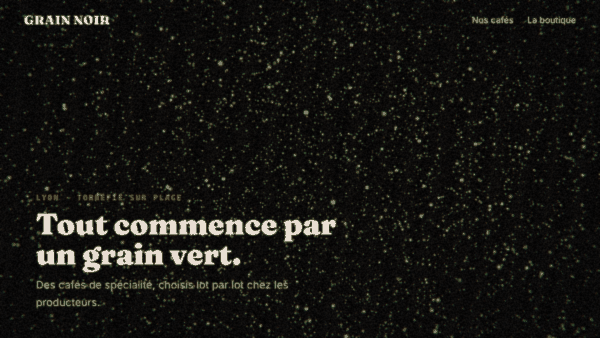
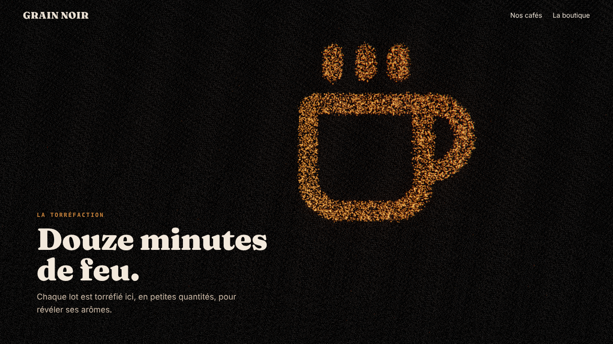
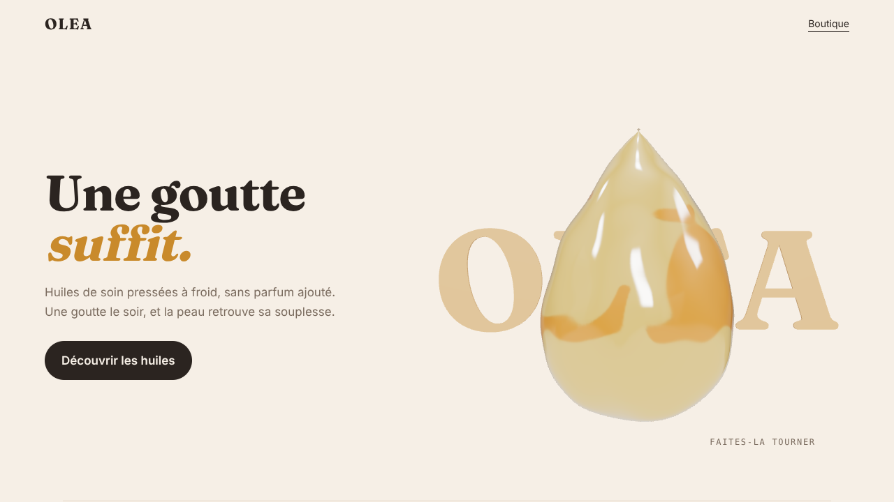
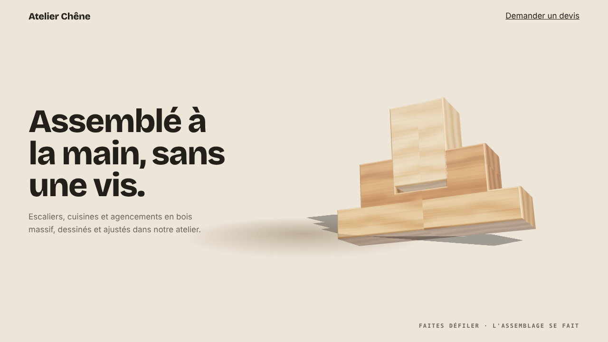
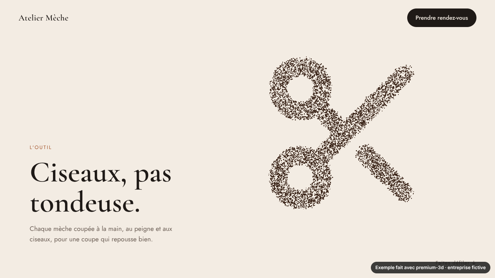
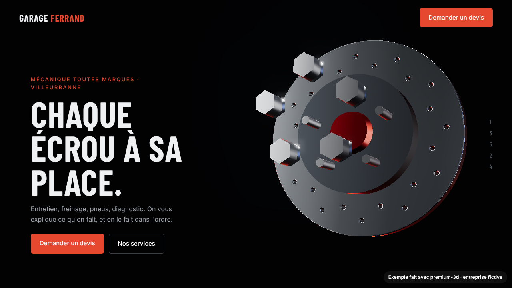
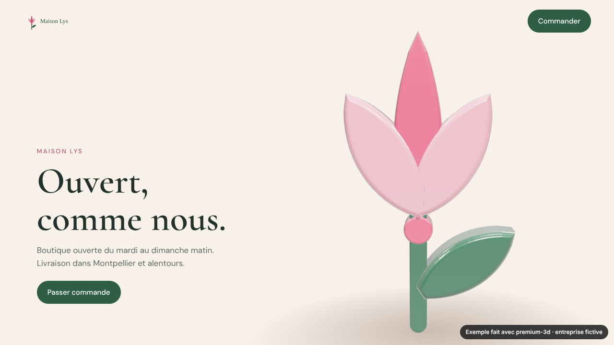
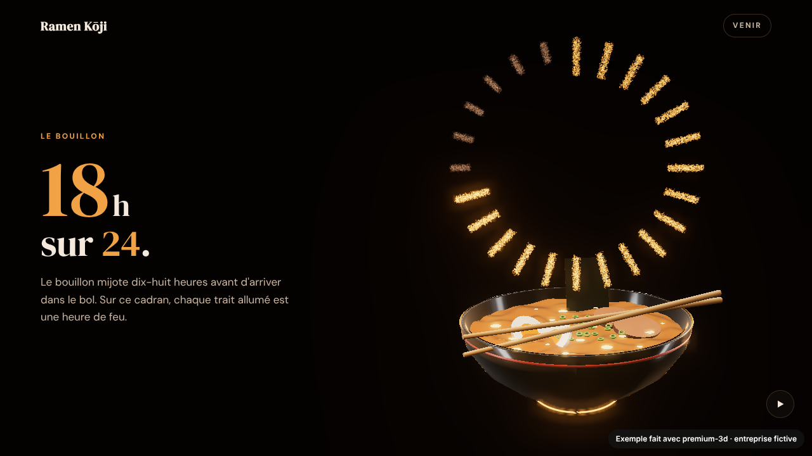

# premium-3d

<a href="https://www.nexahouse.fr"></a> &nbsp;by **[NexaHouse](https://www.nexahouse.fr)**, web studio in Montpellier, France.

**A Claude Code skill that invents a premium real-time 3D scene for each brand.**
Liquid metal, morphing particles, 3D type in the brand's own font, procedural wood and marble,
product models with studio light, neon glass icons, scroll-driven scenes. No templates: every
scene starts from the brand, and two sites made with it should never look alike.

[Page de test](https://wazox.github.io/premium-3d) | [Version française](#version-française)



| Coffee roaster | Natural oils | Carpenter |
|---|---|---|
|  |  |  |
| Green beans roast into a cup, then the name | An oil drop that warps the name behind it | Wooden planks of the logo slide into place |
| **Hair salon** | **Garage** | **Florist** |
| [](examples/coiffeur/) | [](examples/garage/) | [](examples/fleuriste/) |
| A lock of hair in particles gets cut, falls, becomes the scissors, then the initials | Chrome wheel nuts screw in star order, 1-3-5-2-4, like a real mechanic | The client's own SVG logo blooms: a closed bud whose petals open from their base |
| **Ramen bar** | | |
| [](examples/ramen/) | | |
| Steam from the bowl draws the house's three numbers: 18 hours of broth, hand-made noodles, 24 seats. Built by a fresh agent that had never seen the skill (blind test) | | |

*Examples generated with the skill for fictional businesses.*

## How it works

You describe what you want. The skill:

1. **Understands the request**: trade, brand, goal. It only asks what is missing.
2. **Finds a signature**: one detail taken from this specific brand that nobody else would have
   (the shape, the gesture of the trade, its material, its light). If the idea could fit any
   business in the sector, it keeps looking.
3. **Designs from the brand**: palette from the logo, fonts by sector, light or dark, where the 3D
   lives in the page.
4. **Builds** with a tested engine (`lib/`): shader warm-up before the scene shows, rendering paused
   off screen, adaptive pixel ratio, one animation loop, reduced-motion and no-WebGL fallbacks.
5. **Grades itself**: desktop and mobile screenshots, a score out of 10 on originality, relevance,
   finish, readability, smoothness and mobile. Under 8 on anything, it fixes and grades again.

## Install

As a plugin (recommended):

```bash
claude plugin marketplace add Wazox/premium-3d
claude plugin install premium-3d@premium-3d
```

Then in Claude Code: `/premium-3d:premium-3d a landing page for my hair salon with my logo in 3D`.

Or copy `plugins/premium-3d/skills/premium-3d` into `~/.claude/skills/` and use `/premium-3d`.

## What's inside

| Module | What it does |
|---|---|
| `core.js` | Stage, device tier (low/mid/high), studio reflections, materials (glass, frosted, metal, enamel, soft), bloom, scroll tracking, camera paths, framing in a screen zone next to the text (`fitZone`), warm-up, adaptive quality, `dispose()` |
| `shaders.js` | `liquify` (molten metal, jelly, water surfaces), `dissolve` (burn-in reveal with a glowing edge) |
| `particles.js` | Particles shaped from a photo, an SVG logo, text, a 3D mesh or your own function (`shape()`), morphing between shapes |
| `text3d.js` | 3D text in any `.ttf/.otf/.woff` font, letter by letter |
| `logo3d.js` | SVG logo to extruded 3D pieces in their original colors, custom pivots (petals, doors, lids), exploded view and assembly |
| `textures.js` | Procedural wood, marble, concrete, paper (no image files) |
| `forms.js` | Modeling helpers for real-world objects: smoothed lathe profiles, thick glass walls, liquid that fills up, organic shapes (bread, stone, fruit), painted vertex colors |
| `models.js` | `.glb/.gltf` loading (Draco, Meshopt, KTX2 textures), three-point studio light, soft ground shadow sized per device |
| `interact.js` | Drag to rotate with inertia, hover picking, pointer light, device tilt |
| `fx.js` | Film grain, chromatic aberration, vignette, depth of field |
| `icon3d.js` + `icons/` | 78 Lucide icons as neon tubes inside glass |
| `objects3d.js` | Glass photo frames, pedestals, glow rings, dust, animated aurora |
| `story.js` | Multi-act scroll stories: named acts, stepped progress, captions that never overlap |
| `react.js` | `usePremium3D` hook for React and Next.js (mount, warm-up, cleanup) |
| `r3f.js` | React Three Fiber components: `<Studio>`, `<Material>`, `<Logo3D>`, `<Text3D>`, `<Particles>` |
| `splat.js` | Real 3D scans (Gaussian splatting, `.spz`/`.ply`) of the client's actual place or product, via Spark |

Plus `tools/new.mjs` (starter page with all the plumbing and no design), `bench/` (blind-agent benchmark to compare versions), `references/` (one-line API reference, concepts, art direction, performance, integration for HTML, Symfony,
WordPress, React/Next/Vue), `tools/brand.mjs` (pulls colors, fonts, logo and copy from a client's
existing site), `tools/check.mjs` (desktop + real-phone screenshots, console errors, overflow,
3D cut off at the edge or hidden under text, performance budget, title close-ups, visual report with the jury
scores, real scroll FPS when a GPU is present) `tools/record.mjs` (live 1920×1080 screen video of any page) and `tools/render.mjs` (frame-perfect
video rendered frame by frame, even without a GPU, landscape or vertical for reels; works on any WebGL page,
React Three Fiber included, and renders in parallel). All tools use your GPU when there is a screen
(`--gpu` / `--cpu` to force) and close cookie banners on their own.

## Requirements

A browser with WebGL 2. three.js `0.186.1` from a CDN import map or npm. For the screenshot checks:
Node.js and `npm i playwright`.

## Need it done for you?

premium-3d is made by **[NexaHouse](https://www.nexahouse.fr)**, a web studio in Montpellier that builds
custom websites, apps and SaaS. If you want a 3D website without touching code, or want this
integrated into your existing site (Symfony, WordPress, React…): [contact@nexahouse.fr](mailto:contact@nexahouse.fr)
or [book a call](https://calendly.com/yayou3412/appel-decouverte).

If the skill helped you, a star or a link back to this repo is always appreciated.

## License

MIT for this project. three.js and Lenis (MIT), Lucide icons (ISC) and fonts (SIL OFL 1.1) keep
their own licenses, included in `licenses/`.

---

## Version française

**Un skill Claude Code qui invente une scène 3D haut de gamme pour chaque marque.**
Métal liquide, particules qui changent de forme, texte 3D dans la police de la marque, bois et
marbre générés, modèles produits en lumière studio, icônes néon, scènes au scroll. Aucun modèle
tout fait : chaque scène part de la marque, et deux sites faits avec ne doivent jamais se
ressembler.

**Comment il travaille** : il comprend la demande (et ne pose que les questions qui manquent),
trouve une *signature* propre à la marque, fait la direction artistique à partir du logo, construit
avec un moteur optimisé, puis passe un *jury* (captures ordinateur et mobile, note sur 6 critères,
il recommence sous 8/10).

**Installation**

```bash
claude plugin marketplace add Wazox/premium-3d
claude plugin install premium-3d@premium-3d
```

Puis dans Claude Code : `/premium-3d:premium-3d une landing pour mon salon de coiffure avec mon logo en 3D`.
Ou copiez `plugins/premium-3d/skills/premium-3d` dans `~/.claude/skills/` et utilisez `/premium-3d`.

Guide complet en français : [docs/GUIDE-FR.md](docs/GUIDE-FR.md).

**Besoin qu'on le fasse pour vous ?** premium-3d est créé par [NexaHouse](https://www.nexahouse.fr), studio web à
Montpellier (sites, applications, SaaS sur mesure). Site 3D clé en main ou intégration dans votre site existant :
[contact@nexahouse.fr](mailto:contact@nexahouse.fr) ou [réserver un appel](https://calendly.com/yayou3412/appel-decouverte).

Créé par [Yannis El Hajaoui](https://www.linkedin.com/in/yannis-el-hajaoui-a70a56417) · NexaHouse. Contributions bienvenues.
